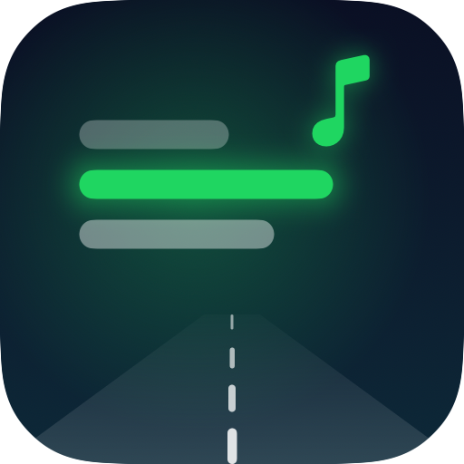
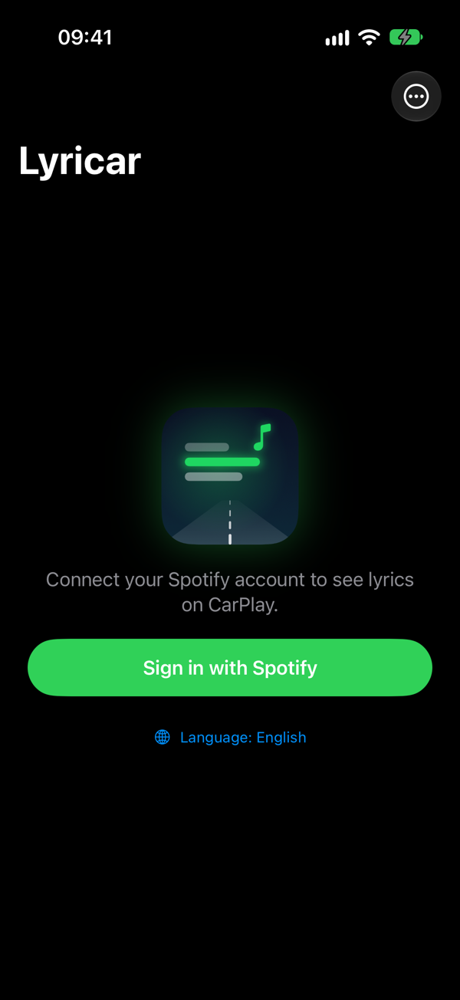
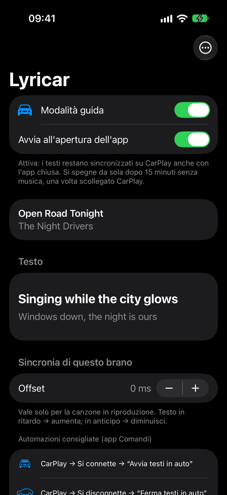

<p align="center">
  
</p>

<h1 align="center">Lyricar</h1>

<p align="center"><b>Synced Spotify lyrics on your CarPlay dashboard.</b></p>

<p align="center">
  
  
  
  
  <a href="LICENSE"></a>
</p>

<p align="center"><i>🇮🇹 <a href="docs/GUIDA.md">Guida completa in italiano</a> · riassunto in fondo</i></p>

Lyricar is an iOS app that shows the lyrics of the song currently playing on Spotify on **CarPlay**, line by line and in sync with the music. The lyrics appear in a Live Activity, with a widget as an alternative.

<p align="center">
  
  &nbsp;
  
  &nbsp;
  
</p>
<p align="center">
  <sub>Sign in · Lyrics in sync with Driving Mode on · Same screen in Italian</sub>
</p>

<p align="center">
  
  <br>
  <sub>The current line also follows you in the Dynamic Island, the Lock Screen and on CarPlay through a Live Activity.</sub>
</p>

<sub>Screenshots use Lyricar's built-in demo mode, with a made-up song and lyrics.</sub>

> [!WARNING]
> **Drive safely.** Reading while driving is distracting. Treat Lyricar like a navigation app and only glance at it, or leave it to your passengers.
> Lyricar is a **personal-use project**. It is not on the App Store and could not be, because it uses background techniques that App Review does not allow.

---

## Features

- 🎵 **Real-time synced lyrics.** The current line is shown in large type, with the next one underneath.
- 🚗 **CarPlay support.** The lyrics appear in a Live Activity on the CarPlay dashboard (iOS 26+). They also show on the Lock Screen and in the Dynamic Island.
- ⏯️ **Follows your playback.** Skips, seeks, pauses and track changes are picked up within about 3 seconds.
- 📞 **Survives phone calls.** Driving Mode keeps running in the background, even through interruptions.
- 🎚️ **Per-song sync offset.** If one song's lyrics are off, you can fix that song without affecting the others.
- 🤖 **Shortcuts automations.** Driving Mode can start when CarPlay connects and stop when it disconnects.
- 🌍 **English and Italian.** Lyricar follows your iPhone's language, or you can pick one in *Settings → Lyricar → Language*.
- 🩺 **Built-in diagnostics.** An in-app event log helps you find out what happened during a drive.
- 🔒 **No server, no secrets.** Everything runs on your iPhone. Spotify login uses OAuth PKCE, so no client secret is needed.

## How it works (in short)

```
 Spotify Web API ──► what's playing + position ─┐
                                                ├─► Lyricar (iPhone) ──► Live Activity ──► CarPlay
 LRCLIB ──────────► time-stamped lyrics (LRC) ──┘        │
                                                         └──────────► Widget (fallback)
```

Lyricar asks Spotify every 3 seconds which song is playing and how far into it you are. It downloads the time-stamped lyrics from [LRCLIB](https://lrclib.net), works out which line should be on screen, and updates a Live Activity, which iOS 26 mirrors to CarPlay.

👉 For the full explanation, see **[docs/GUIDE.md](docs/GUIDE.md)** (🇮🇹 [docs/GUIDA.md](docs/GUIDA.md)): architecture, why a Live Activity instead of a widget, how the app stays alive in the background, and troubleshooting.

## Requirements

| What | Why |
|---|---|
| Mac with **Xcode 26+** | To build and install the app |
| iPhone with **iOS 26+** | Live Activities and widgets on CarPlay |
| A car with **CarPlay** (wired or wireless) | To see the lyrics while driving |
| **Apple Developer Program** membership | With a free Apple ID the app expires after 7 days and App Groups may not be available |
| **Spotify Premium** (for whoever creates the Spotify app) | Spotify's Web API requires it |

## Quick start

> New to this? The **[step-by-step guide](docs/GUIDE.md#setup-step-by-step)** explains every step in detail, including how to get each ID.

1. **Create a Spotify app** at [developer.spotify.com/dashboard](https://developer.spotify.com/dashboard):
   - Redirect URI: `lyricar://callback`
   - API: **Web API** only
   - In **User Management**, add the email of every Spotify account that will use the app
   - Copy the **Client ID**
2. **Clone and configure** the project:
   ```sh
   git clone https://github.com/Gennaro0408-bit/lyricar.git
   cd lyricar
   cp Config/Local.xcconfig.example Config/Local.xcconfig
   ```
   Then edit `Config/Local.xcconfig`:
   ```
   DEVELOPMENT_TEAM = ABCDE12345            // your Apple Team ID
   APP_BUNDLE_ID = com.yourname.lyricar     // any unique bundle ID
   SPOTIFY_CLIENT_ID = your_client_id
   ```
3. **Build and run.** Open `Lyricar.xcodeproj`, select your iPhone and press **▶︎ Run**.
4. **First launch.** Tap **Sign in with Spotify**, allow location access *while using the app*, and play a song.

## Project structure

```
App/        iOS app: Spotify login, lyrics engine, Driving Mode, diagnostics UI
Widget/     WidgetKit widget + Live Activity UI
Shared/     Code shared by app & widget: Spotify API, LRCLIB client, LRC parser, Keychain, settings
Config/     Build settings (Base.xcconfig is committed; your Local.xcconfig is git-ignored)
docs/       Guides (English: GUIDE.md · Italiano: GUIDA.md) and images
tools/      render-logo.swift: regenerates the logo and app icon
project.yml XcodeGen project definition (Lyricar.xcodeproj is generated from it)
```

If you change `project.yml`, regenerate the Xcode project with [XcodeGen](https://github.com/yonaskolb/XcodeGen):

```sh
brew install xcodegen
xcodegen generate
```

### Demo mode and screenshots

Launch the app with the `-LyricarDemo` argument (in Xcode: **Product → Scheme → Edit Scheme → Run → Arguments**) to show a made-up song with synced lyrics, without signing in to Spotify. It's what the screenshots above use.

The logo and app icon are drawn in SwiftUI. To regenerate them, run:

```sh
swift tools/render-logo.swift
```

## Known limitations

- **Lyrics availability and accuracy depend on LRCLIB.** If LRCLIB has the lyrics for a different version of a song (radio edit, live, remaster), they can be out of sync. Use the per-song offset to fix them.
- **Spotify development mode.** Only the accounts listed in your Spotify app's *User Management* can sign in.
- **The background techniques** (silent audio and background location) are fine for personal use, but App Store review would reject them.

## Privacy

- Everything runs on your device. There is no backend and no analytics.
- Spotify tokens are stored in the iOS Keychain.
- Location is used only to keep the app alive while driving. It is never stored or sent anywhere.
- The only network requests go to `accounts.spotify.com`, `api.spotify.com` and `lrclib.net`.

## Credits

- Lyrics: [LRCLIB](https://lrclib.net), a free, open, community-driven lyrics database
- Playback data: [Spotify Web API](https://developer.spotify.com/documentation/web-api)

Lyricar is not affiliated with, endorsed by, or sponsored by Spotify or Apple. Lyrics belong to their respective rights holders.

## License

[MIT](LICENSE) © 2026 Gennaro Giuseppe Di Maro

---

## 🇮🇹 In breve, in italiano

**Lyricar** mostra su **CarPlay** il testo sincronizzato della canzone che stai ascoltando su Spotify. Funziona tramite una Live Activity che l'app aggiorna in tempo reale mentre guidi.

- **Cosa serve:** un Mac con Xcode 26, un iPhone con iOS 26, un account Apple Developer e un account Spotify Premium per creare l'app Spotify.
- **Come si installa:** segui la **[guida completa in italiano](docs/GUIDA.md)**. Spiega passo passo come ottenere il **Client ID Spotify** e il **Team ID Apple**, come scegliere il **Bundle ID**, e come risolvere i problemi più comuni.
- **Lingua:** l'app è in italiano e in inglese e segue la lingua dell'iPhone. Puoi sceglierla anche solo per Lyricar in *Impostazioni → Lyricar → Lingua*.
- **Sicurezza:** leggi solo con un'occhiata, come faresti con il navigatore.
