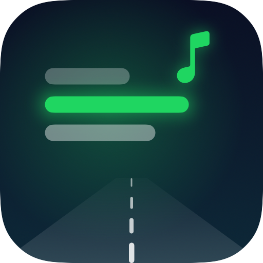

# Lyricar: la guida completa

Questa guida spiega **come funziona Lyricar** e ti accompagna **passo passo nella configurazione**, compreso dove trovare ogni codice. Alla fine trovi la soluzione ai problemi più comuni.

🇬🇧 *English version: [GUIDE.md](GUIDE.md)*

**Indice**

1. [Come funziona Lyricar](#1-come-funziona-lyricar)
2. [Cosa ti serve](#2-cosa-ti-serve)
3. [Configurazione passo passo](#configurazione-passo-passo)
   - [Passo 1: Crea l'app Spotify e ottieni il Client ID](#passo-1-crea-lapp-spotify-e-ottieni-il-client-id)
   - [Passo 2: Scegli come installare l'app](#passo-2-scegli-come-installare-lapp)
     - [Metodo A: Xcode (account a pagamento o gratuito)](#metodo-a-xcode-account-a-pagamento-o-gratuito)
     - [Metodo B: AltStore o SideStore](#metodo-b-altstore-o-sidestore)
     - [Metodo C: Sideloadly](#metodo-c-sideloadly)
     - [Metodo D: TestFlight](#metodo-d-testflight)
     - [Altri metodi](#altri-metodi)
   - [Passo 3: Primo avvio](#passo-3-primo-avvio)
   - [Passo 4: Preparalo per l'auto](#passo-4-preparalo-per-lauto)
4. [Usare l'app](#4-usare-lapp)
5. [Risoluzione dei problemi](#5-risoluzione-dei-problemi)
6. [Quanto dura l'app installata?](#6-quanto-dura-lapp-installata)
7. [Domande frequenti](#7-domande-frequenti)

---

## 1. Come funziona Lyricar

### Il quadro generale

```
                      ogni 3 s
 ┌──────────────┐  "cosa suona e          ┌─────────────────────────────┐
 │ Spotify      │   a che punto?"         │ Lyricar (iPhone)            │
 │ Web API      │ ──────────────────────► │                             │
 └──────────────┘                         │  1. sa brano e posizione    │
                                          │  2. trova la riga giusta    │      ┌──────────┐
 ┌──────────────┐  una volta per brano    │  3. aggiorna la Live        │ ───► │ CarPlay  │
 │ LRCLIB       │  "testo con             │     Activity a ogni riga    │      │          │
 │ (lrclib.net) │   i tempi"              │                             │      └──────────┘
 └──────────────┘ ──────────────────────► └─────────────────────────────┘
```

Lyricar usa due fonti di dati:

- **Spotify Web API.** iOS non permette a un'app di sapere cosa sta suonando un'altra app, quindi Lyricar lo chiede direttamente ai server di Spotify (endpoint `currently-playing`). Spotify risponde con il brano, se sta suonando e la **posizione in millisecondi**. Per questo devi accedere con Spotify.
- **LRCLIB.** Spotify non fornisce i testi alle app di terze parti. Lyricar li scarica da [LRCLIB](https://lrclib.net), un database libero e gratuito di testi in formato **LRC**, in cui ogni riga ha il suo tempo:
  ```
  [00:12.40] Prima riga della canzone
  [00:15.90] Seconda riga
  ```
  I testi vengono salvati sul telefono, così ogni brano si scarica una volta sola.

### Come resta sincronizzato

Quando Spotify dice che il brano è alla posizione `p`, Lyricar calcola il momento in cui il brano è iniziato:

```
inizio brano = (momento della richiesta) − p
```

Cinque volte al secondo l'app confronta l'ora attuale con quell'inizio e sceglie la riga il cui tempo è appena passato. Ogni 3 secondi ricontrolla con Spotify:

- se la stima si è spostata **meno di 1 secondo**, la corregge piano piano, per non risentire delle variazioni della rete;
- se è sbagliata di **più di 1 secondo**, hai saltato, riavvolto o ripreso la riproduzione, quindi si riallinea subito;
- se è cambiato il **brano**, scarica il nuovo testo.

A tutto questo si aggiunge l'**offset per brano**, per le canzoni il cui testo su LRCLIB è leggermente sfasato.

### Perché una Live Activity e non solo un widget?

La prima versione usava solo un **widget**. Si desincronizzava e a volte si bloccava, per due motivi:

- Un widget non può eseguire codice in continuazione. Consegna a iOS una *timeline* di "pagine" già calcolate, ciascuna con un orario, e iOS decide quando ridisegnarle davvero. Su CarPlay possono arrivare **con secondi di ritardo**.
- iOS concede a ogni widget un **numero limitato di aggiornamenti al giorno**. Esaurito quello, il widget non si aggiorna più.

Una **Live Activity** (la stessa tecnologia dei riquadri delle consegne o dei risultati sportivi) può invece essere aggiornata dall'app quando vuole, e da iOS 26 compare anche su **CarPlay**. Lyricar la aggiorna a ogni cambio di riga. Il widget resta disponibile come alternativa più semplice.

### Modalità guida: restare attiva in background

Per aggiornare la Live Activity l'app deve continuare a funzionare in background, con lo schermo bloccato e il telefono in tasca. Di solito iOS sospende le app in background dopo pochi secondi, quindi la **Modalità guida** usa due tecniche insieme:

| Tecnica | Cosa fa | Punto debole |
|---|---|---|
| **Audio silenzioso** | Riproduce silenzio mixato con Spotify, senza mai interrompere o abbassare la musica. iOS tiene attive le app che riproducono audio. | Una **telefonata** o Siri lo interrompe, e iOS potrebbe non farlo ripartire. |
| **Posizione in background** | Usa lo stesso meccanismo dei navigatori. In alto vedrai la freccia della posizione. | Serve il permesso di accesso alla posizione. |

Con entrambe attive, una telefonata non blocca più i testi. La posizione **non viene mai salvata né inviata**: serve solo a tenere sveglia l'app.

La Modalità guida si spegne da sola quando **non c'è musica da 15 minuti e CarPlay è scollegato**. Puoi spegnerla anche a mano o con un'automazione.

> Queste tecniche sono il motivo per cui Lyricar è un progetto personale: l'App Store non accetta app che le usano solo per restare attive.

### Dove finiscono i tuoi dati

| Dato | Dove si trova |
|---|---|
| Accesso a Spotify (token) | Portachiavi di iOS, solo sul telefono |
| Testi | Cache sul telefono |
| Impostazioni, offset, diagnostica | Solo sul telefono |
| Richieste di rete | Solo verso `accounts.spotify.com`, `api.spotify.com` e `lrclib.net` |

Non esiste un server di Lyricar e non ci sono statistiche d'uso.

---

## 2. Cosa ti serve

**Sempre:**

- [ ] Un **iPhone** con **iOS 26** o successivo
- [ ] Un'auto con **CarPlay**, via cavo o wireless
- [ ] Un **account Spotify**, più l'accesso a un account **Spotify Premium** per creare l'app Spotify (vedi il [Passo 1](#passo-1-crea-lapp-spotify-e-ottieni-il-client-id))
- [ ] Un **Apple ID**, gratuito o con abbonamento all'Apple Developer Program

**In base a come installi** (vedi il [Passo 2](#passo-2-scegli-come-installare-lapp)):

- un **Mac con Xcode 26** (Metodo A), oppure
- un **Mac o un PC Windows** per AltServer, per la configurazione iniziale di SideStore o per Sideloadly (Metodi B e C)

---

## Configurazione passo passo

Qualunque metodo scegli, si parte sempre creando la tua app Spotify (Passo 1). Poi scegli come mettere Lyricar sull'iPhone (Passo 2).

### Passo 1: Crea l'app Spotify e ottieni il Client ID

Il **Client ID** dice a Spotify quale app sta chiedendo l'accesso. **Non è un segreto**: non serve nessuna password, perché Lyricar usa il login sicuro *PKCE*.

1. Vai su **[developer.spotify.com/dashboard](https://developer.spotify.com/dashboard)** ed entra con il tuo account Spotify.
2. Se te lo chiede, accetta i **Developer Terms of Service**.
3. Premi **Create app** e compila il modulo:

   | Campo | Cosa scrivere |
   |---|---|
   | **App name** | `Lyricar` (va bene qualsiasi nome) |
   | **App description** | `Testi sincronizzati su CarPlay` (va bene qualsiasi testo) |
   | **Website** | lascialo vuoto |
   | **Redirect URIs** | `lyricar://callback`, poi premi **Add** |
   | **Which API/SDKs…** | ✅ solo **Web API**. **Non** spuntare iOS, Android o le altre voci. |

4. Spunta la casella dei Terms e premi **Save**.
5. Nella pagina dell'app premi **Settings** (in alto a destra).
6. In **Basic Information** copia il **Client ID**: una stringa di 32 caratteri tra lettere e numeri. Il *Client secret* **non** serve, quindi non condividerlo mai.
7. Sempre in **Settings**, apri la scheda **User Management** e aggiungi **nome ed email di ogni account Spotify** che accederà a Lyricar, **compreso il tuo** se è diverso dall'account che ha creato l'app. Per ogni account usa l'email che compare su [spotify.com/account](https://www.spotify.com/account).

> [!IMPORTANT]
> **"Non riesco a spuntare Web API" / "Upgrade to Spotify Premium to access the Web API"**
>
> Spotify permette di usare la Web API in development mode solo agli account **Premium**.
> - Controlla di essere entrato con l'account giusto: confronta l'angolo in alto a destra della dashboard con [spotify.com/account](https://www.spotify.com/account). Prova anche con una finestra in incognito.
> - **Membri di un piano Famiglia o Duo:** la casella potrebbe restare disattivata. Chiedi al **gestore del piano** di creare l'app con il suo account e di aggiungere *te* in **User Management**.
> - **Va bene anche l'account Premium di un'altra persona.** Chi ha Premium crea l'app e aggiunge la tua email in User Management. Tu poi accedi a Lyricar con **il tuo** account e vedi **la tua** musica. Quella persona deve mantenere Premium e non cancellare l'app dalla sua dashboard.

### Passo 2: Scegli come installare l'app

Apple permette di usare app che non vengono dall'App Store solo se sono **firmate con un certificato** legato a un account Apple. Il metodo che scegli decide quale certificato si usa e **per quanto tempo l'app funziona** prima di doverla rinnovare.

| Metodo | Cosa serve | Certificato | L'app dura | Impegno |
|---|---|---|---|---|
| **[A. Xcode + account a pagamento](#metodo-a-xcode-account-a-pagamento-o-gratuito)** ⭐ | Mac + Xcode, Apple Developer Program (99 €/anno) | Il tuo certificato da sviluppatore | **1 anno** | Una volta sola |
| **[A. Xcode + Apple ID gratuito](#metodo-a-xcode-account-a-pagamento-o-gratuito)** | Mac + Xcode | Certificato personale gratuito | **7 giorni**, poi va reinstallata | Ogni settimana |
| **[B. AltStore o SideStore](#metodo-b-altstore-o-sidestore)** | Mac o PC Windows (per la configurazione), Apple ID gratuito | Certificato personale gratuito | **7 giorni, rinnovati in automatico** | Automatico in background |
| **[C. Sideloadly](#metodo-c-sideloadly)** | Mac o PC Windows, Apple ID gratuito o a pagamento | Gratuito (7 giorni) o a pagamento (1 anno) | **7 giorni** o **1 anno** | Ogni settimana con l'ID gratuito |
| **[D. TestFlight](#metodo-d-testflight)** | L'app **TestFlight**. Chi la condivide deve avere un account a pagamento. | Di Apple (App Store) | **90 giorni** per build | Aggiorni da TestFlight |
| **[Altri metodi](#altri-metodi)** | — | Servizi di firma, certificati enterprise… | Dipende | Leggi le note |

> **Quale scegliere?** Se hai un Mac, il **Metodo A** è il più semplice ed è l'unico provato dall'inizio alla fine. Con l'account a pagamento installi una volta all'anno. Senza Mac, usa il **Metodo B**: AltStore o SideStore rinnovano l'app per te ogni settimana.

> [!NOTE]
> **Gli Apple ID gratuiti hanno dei limiti:** le app durano 7 giorni, puoi avere al massimo **3 app installate così** contemporaneamente e registrare al massimo **10 App ID a settimana**. Lyricar ne usa 2 (l'app e il widget). Se l'App Group non è disponibile l'app funziona lo stesso, ma il **widget** non vede l'accesso a Spotify. La Live Activity su CarPlay non ne risente.

### Metodo A: Xcode (account a pagamento o gratuito)

Compili Lyricar dal codice sorgente e lo installi direttamente dal Mac. Scriverai tre valori in un unico file:

| Valore | Esempio | Da dove arriva |
|---|---|---|
| `SPOTIFY_CLIENT_ID` | `1a2b3c4d5e6f…` (32 caratteri) | Dashboard sviluppatori Spotify ([Passo 1](#passo-1-crea-lapp-spotify-e-ottieni-il-client-id)) |
| `DEVELOPMENT_TEAM` | `ABCDE12345` (10 caratteri) | Il tuo account Apple ([A1](#a1-trova-il-tuo-team-id-apple)) |
| `APP_BUNDLE_ID` | `com.tuonome.lyricar` | Lo scegli tu ([A2](#a2-scegli-un-bundle-id)) |

**A pagamento o gratuito?** Funzionano allo stesso modo. Con l'**Apple Developer Program** (99 €/anno) l'app dura **un anno**. Con un **Apple ID gratuito** basta aggiungerlo in Xcode → Impostazioni → Account: Xcode crea un *Personal Team*, ma l'app scade dopo **7 giorni** e dovrai premere di nuovo ▶︎ Run.

#### A1. Trova il tuo Team ID Apple

Il **Team ID** è un codice di 10 caratteri che identifica il tuo account sviluppatore Apple. Xcode lo usa per firmare l'app.

**Opzione A: dal sito (la più semplice)**
1. Vai su **[developer.apple.com/account](https://developer.apple.com/account)** ed entra.
2. Scorri fino a **Membership details** (Dettagli abbonamento).
3. Copia il **Team ID**, per esempio `ABCDE12345`.

Già che ci sei, guarda la **Expiration Date** (data di scadenza) dell'abbonamento: ti servirà nella [sezione 6](#6-quanto-dura-lapp-installata).

**Opzione B: da Accesso Portachiavi sul Mac**
1. Apri **Accesso Portachiavi** e cerca `Apple Development`.
2. Fai doppio clic sul certificato.
3. Il campo **Unità organizzativa** è il tuo Team ID.

**Opzione C: da Xcode**
1. **Xcode → Impostazioni → Account.** Aggiungi il tuo Apple ID se non c'è.
2. Apri un progetto qualsiasi, seleziona un target → **Signing & Capabilities** e scegli il tuo team. Il Team ID compare poi in **Build Settings → Development Team**.

#### A2. Scegli un Bundle ID

Il **Bundle ID** è l'identificativo unico dell'app, scritto "al contrario" come un dominio internet. **Lo inventi tu**, ma deve essere unico tra tutti gli sviluppatori Apple. Buoni esempi:

```
com.tuonome.lyricar
io.github.tuonomegithub.lyricar
```

Usa solo lettere, numeri, punti e trattini. Lyricar ricava da solo gli altri identificativi:

| Identificativo | Valore |
|---|---|
| App | `com.tuonome.lyricar` |
| Widget | `com.tuonome.lyricar.widget` |
| App Group (permette ad app e widget di condividere il login) | `group.com.tuonome.lyricar` |

Se più avanti Xcode dice che il Bundle ID *"is not available"* o *"already in use"*, scegline semplicemente un altro.

#### A3. Configura il progetto

1. Scarica il progetto:
   ```sh
   git clone https://github.com/Gennaro0408-bit/lyricar.git
   cd lyricar
   ```
   Non hai git? Su GitHub premi **Code → Download ZIP** ed estrai l'archivio.
2. Crea il tuo file di configurazione personale partendo dal modello:
   ```sh
   cp Config/Local.xcconfig.example Config/Local.xcconfig
   ```
   Oppure, nel Finder, duplica `Config/Local.xcconfig.example` e rinomina la copia in `Local.xcconfig`.
3. Apri `Config/Local.xcconfig` con un qualsiasi editor di testo e inserisci i tuoi tre valori:
   ```
   DEVELOPMENT_TEAM = ABCDE12345
   APP_BUNDLE_ID = com.tuonome.lyricar
   SPOTIFY_CLIENT_ID = 1a2b3c4d5e6f7a8b9c0d1e2f3a4b5c6d
   ```
   Senza virgolette e senza nient'altro su quelle righe.

`Local.xcconfig` è nel `.gitignore`, quindi i tuoi codici **non finiscono mai su GitHub**, anche se pubblichi la tua copia del progetto.

> **Redirect personalizzato (facoltativo):** se la tua app Spotify usa già un altro redirect, per esempio `miaapp://callback`, aggiungi `CALLBACK_SCHEME = miaapp` a `Local.xcconfig`. Il Redirect URI sulla dashboard Spotify deve essere sempre `<CALLBACK_SCHEME>://callback`.

#### A4. Compila e installa

1. Fai doppio clic su **`Lyricar.xcodeproj`** per aprirlo in Xcode.
2. Collega l'iPhone con il cavo, sbloccalo e, se te lo chiede, tocca **Autorizza**.
3. Sull'iPhone attiva la **Modalità sviluppatore**: **Impostazioni → Privacy e sicurezza → Modalità sviluppatore**. L'iPhone si riavvia.
4. Nella barra in alto di Xcode scegli il tuo iPhone come destinazione.
5. Premi **▶︎ Run** (oppure ⌘R).

La prima volta Xcode registra i Bundle ID e l'App Group sul tuo account. È l'opzione **Automatically manage signing**, che deve restare attiva. Lascia fare a Xcode: **non** serve scaricare o importare profili a mano.

Se l'iPhone dice *"Sviluppatore non autorizzato"*, vai in **Impostazioni → Generali → VPN e gestione dispositivi**, tocca il tuo account sviluppatore e poi **Autorizza**.

### Metodo B: AltStore o SideStore

[AltStore](https://altstore.io) e [SideStore](https://sidestore.io) sono strumenti gratuiti che installano app con **il tuo Apple ID** e le **rinnovano in automatico** prima che scadano i 7 giorni. Non serve Xcode e non serve un Mac: va bene anche Windows.

| | AltStore | SideStore |
|---|---|---|
| Configurazione | Installi **AltServer** su un Mac o PC Windows, poi AltStore sull'iPhone | Il computer serve **solo una volta**, per la configurazione |
| Rinnovo settimanale | Automatico, quando l'iPhone e il computer con AltServer sono sulla **stessa rete Wi-Fi** | Automatico, **dal solo iPhone**, tramite un'app VPN locale |

1. Installa AltStore o SideStore seguendo la guida ufficiale sul loro sito.
2. Sull'iPhone scarica **`Lyricar.ipa`** dall'[ultima release](https://github.com/Gennaro0408-bit/lyricar/releases/latest) su GitHub.
3. Apri AltStore o SideStore → **My Apps** → **+** e seleziona `Lyricar.ipa`.
4. Se te lo chiede, inserisci il tuo Apple ID. Lo strumento firma Lyricar con il tuo certificato gratuito.
5. Vai al [Passo 3: Primo avvio](#passo-3-primo-avvio). Questa versione non ha un Client ID incorporato, quindi Lyricar ti chiederà di **incollare il tuo Client ID Spotify**.

> [!NOTE]
> Questi strumenti cambiano Bundle ID e App Group dell'app per adattarli al tuo account. Lyricar se ne accorge da sola. Nel caso peggiore solo il **widget** non vede l'accesso a Spotify, mentre Live Activity e CarPlay continuano a funzionare.
> Questo metodo **non è ancora stato provato dall'inizio alla fine** con Lyricar. Se qualcosa non va, apri una [segnalazione](https://github.com/Gennaro0408-bit/lyricar/issues).

### Metodo C: Sideloadly

[Sideloadly](https://sideloadly.io) è un programma gratuito per Mac e Windows che firma e installa un file `.ipa` via cavo o Wi-Fi.

1. Scarica **`Lyricar.ipa`** dall'[ultima release](https://github.com/Gennaro0408-bit/lyricar/releases/latest).
2. Apri Sideloadly, collega l'iPhone, trascina `Lyricar.ipa` nella finestra e inserisci il tuo Apple ID.
3. Premi **Start**. Sull'iPhone autorizza il certificato in **Impostazioni → Generali → VPN e gestione dispositivi** e, se richiesto, attiva la **Modalità sviluppatore**.
4. Vai al [Passo 3: Primo avvio](#passo-3-primo-avvio) e incolla il tuo Client ID Spotify quando te lo chiede.

Con un **Apple ID gratuito** l'app dura **7 giorni**: ripeti i passaggi qui sopra (le impostazioni restano). Con un account sviluppatore **a pagamento** Sideloadly può firmarla per **un anno**.

> Anche questo metodo non è ancora stato provato dall'inizio alla fine con Lyricar.

### Metodo D: TestFlight

[TestFlight](https://developer.apple.com/testflight/) è l'app ufficiale di Apple per le versioni di prova. Chi ha un **account Apple Developer a pagamento** carica Lyricar una volta, e i tester la installano dall'app TestFlight **come una normale app dell'App Store**: niente computer, niente rinnovo settimanale. Ogni build dura **90 giorni** e gli aggiornamenti arrivano da TestFlight.

La build di TestFlight **non ha un Client ID incorporato**: al primo avvio ogni tester incolla il Client ID della propria app Spotify (vedi il [Passo 3](#passo-3-primo-avvio)).

**Per chi la riceve (tester)**

1. Installa **TestFlight** dall'App Store.
2. Apri il link o l'email di invito e tocca **Accetta / Installa**.
3. Vai al [Passo 3: Primo avvio](#passo-3-primo-avvio).

**Per chi possiede l'account (caricare la build)**

1. Su [App Store Connect](https://appstoreconnect.apple.com) → **App** → **+** → **Nuova app**: piattaforma iOS, un nome (deve essere unico sull'App Store, per esempio *Lyricar – CarPlay Lyrics*), lingua, lo **stesso Bundle ID** di `APP_BUNDLE_ID` e uno SKU qualsiasi.
2. Sul Mac, con il [Metodo A](#metodo-a-xcode-account-a-pagamento-o-gratuito) già configurato, esegui:
   ```sh
   sh tools/testflight.sh upload
   ```
   Lo script compila Lyricar **senza il tuo Client ID**, la firma per l'App Store e la carica. A ogni caricamento il numero di build aumenta da solo.
3. Dopo 5-30 minuti la build compare in App Store Connect → la tua app → **TestFlight**.
4. Aggiungi i tester:
   - **Tester interni** (fino a 100): persone aggiunte al tuo team in **Utenti e accessi**. **Non serve la revisione** e possono installare subito.
   - **Tester esterni** (fino a 10.000, anche tramite un link pubblico): la prima build passa dalla **revisione beta** di Apple.

> [!WARNING]
> **I tester esterni potrebbero essere rifiutati.** Per restare sincronizzata in background, Lyricar usa audio silenzioso e posizione in background, e la revisione di Apple di solito rifiuta queste tecniche quando servono solo a restare attivi. Per i tester interni la revisione non c'è.

> **Limite di Spotify:** in development mode un'app Spotify accetta solo gli account elencati nel suo User Management, e solo pochi. Per questo è meglio che ogni tester crei la **propria** app Spotify e ne incolli il Client ID. Puoi anche aggiungerli alla tua, entro quel limite.

### Altri metodi

- **"Servizi di firma" a pagamento e certificati enterprise condivisi.** Alcuni siti vendono certificati che permettono di installare qualsiasi `.ipa` per un anno. ⚠️ **Sconsigliati:** non sono ufficiali, Apple li revoca spesso (l'app smette di aprirsi all'improvviso) e affidi a sconosciuti un'app che ha accesso al tuo account Spotify.
- **Creare da te il file `.ipa`:** su un Mac esegui `sh tools/build-ipa.sh`. Crea `build/Lyricar.ipa` senza Client ID e senza dati personali, pronto per AltStore, SideStore o Sideloadly.

### Passo 3: Primo avvio

> **Lingua:** Lyricar è in **italiano** e in **inglese** e segue la lingua dell'iPhone. Per scegliere una lingua diversa solo per Lyricar, tocca **Lingua** nell'app (oppure vai in **Impostazioni → Lyricar → Lingua**) e scegli in **Lingua preferita**.

1. Apri **Lyricar**.
   - Se l'hai installata con **AltStore, SideStore o Sideloadly**, compare prima un campo **Client ID Spotify**. Incolla il Client ID del [Passo 1](#passo-1-crea-lapp-spotify-e-ottieni-il-client-id). Controlla che il Redirect URI della tua app Spotify sia esattamente quello mostrato sotto il campo, `lyricar://callback` (il pulsante **Copia** ti aiuta). Puoi cambiarlo più avanti dal menu **⋯** → **Cambia Client ID Spotify**.
2. Tocca **Accedi con Spotify**.
3. Entra con il **tuo** account Spotify, quello aggiunto in User Management. La pagina di accesso ti fa sempre scegliere l'account.
4. Quando ti chiede la **posizione**, scegli **Consenti mentre usi l'app**.
5. Quando ti chiede le **Attività in tempo reale**, consentile. Se te lo sei perso: **Impostazioni → Lyricar → Attività in tempo reale**.
6. Fai partire una canzone su Spotify. Entro pochi secondi dovresti vedere:
   - il testo che scorre nell'app;
   - dopo aver bloccato il telefono, il testo sulla **schermata di blocco** e nella **Dynamic Island**.

### Passo 4: Preparalo per l'auto

**Vedere i testi su CarPlay**

1. Collega l'iPhone all'auto, via cavo o wireless.
2. Controlla che in Lyricar sia attiva la **Modalità guida**. Di serie si accende ogni volta che apri l'app.
3. La Live Activity compare sulla dashboard di CarPlay o nella pagina dei widget (la prima pagina a sinistra). Se non la vedi, controlla in **Impostazioni dell'iPhone → Generali → CarPlay → [la tua auto]** che widget e Attività in tempo reale siano attivi.

**Facoltativo: avvio e arresto automatici**

iOS permette di *avviare* una Live Activity solo con l'app aperta. Queste due automazioni aprono Lyricar quando sali in auto e la fermano quando scendi:

1. Apri l'app **Comandi** → scheda **Automazione** → **+**.
2. Scegli **CarPlay → Si connette → Esegui immediatamente → Avanti**.
3. Cerca l'azione **Avvia testi in auto** di Lyricar e aggiungila. Tocca **Fine**.
4. Ripeti con **CarPlay → Si disconnette** e l'azione **Ferma testi in auto**.

**Facoltativo: aggiungere il widget**

Lyricar include anche un piccolo widget, *Testi Spotify*. È meno preciso della Live Activity, ma non ha bisogno dell'app attiva. Aggiungilo dalla pagina dei widget di CarPlay (tieni premuto → **+**) o dalla schermata Home dell'iPhone.

---

## 4. Usare l'app

- **Interruttore Modalità guida.** Accende gli aggiornamenti in background e la Live Activity.
- **Offset per brano.** Se il testo di una canzone arriva **in ritardo**, aumenta l'offset. Se arriva **in anticipo**, diminuiscilo. Il valore viene salvato **solo per quella canzone**. Con **Azzera l'offset di questo brano** lo annulli, e in fondo alla schermata puoi azzerare quelli di tutti i brani.
- **Diagnostica.** Il registro di cosa è successo: cambi di brano, riallineamenti, interruzioni dell'audio (chiamate, Siri), stato della Live Activity ed errori di rete. Il pulsante di condivisione lo invia come testo, utile per segnalare un problema. Il registro è in inglese.
- **Trascina verso il basso** per forzare subito un controllo con Spotify.
- **Lingua.** Apre la pagina di Lyricar in Impostazioni, dove puoi passare tra italiano e inglese in **Lingua preferita**.

---

## 5. Risoluzione dei problemi

### Spotify e accesso

| Problema | Causa e soluzione |
|---|---|
| Casella Web API grigia / "Upgrade to Spotify Premium" | L'account che crea l'app non è Premium. Leggi il riquadro nel [Passo 1](#passo-1-crea-lapp-spotify-e-ottieni-il-client-id). |
| `INVALID_CLIENT: Invalid redirect URI` | Il redirect sulla dashboard non coincide. Deve essere esattamente `lyricar://callback`, oppure `<CALLBACK_SCHEME>://callback` se l'hai cambiato. |
| `INVALID_CLIENT: Invalid client` | `SPOTIFY_CLIENT_ID` manca o è sbagliato in `Local.xcconfig`. Correggilo e ricompila. |
| *"Account non autorizzato…"* (HTTP 403) dopo l'accesso | Il tuo account Spotify non è nell'elenco **User Management** dell'app sulla dashboard. Aggiungilo. |
| *"Nessun brano in riproduzione"* mentre la musica suona | La musica arriva da un'altra fonte (radio, un'altra app o un altro account), oppure Spotify è in pausa. |

### Installazione

| Errore | Soluzione |
|---|---|
| *Signing for "Lyricar" requires a development team* | Manca `DEVELOPMENT_TEAM` in `Config/Local.xcconfig`, oppure Xcode l'ha sovrascritto. Controlla il file, poi in **Signing & Capabilities** verifica che *Automatically manage signing* sia attivo e che non ci sia un team impostato a mano. |
| *Embedded binary's bundle identifier is not prefixed with the parent app's bundle identifier* | Qualcuno ha modificato a mano i Bundle ID in Xcode. Annulla le modifiche (oppure rigenera il progetto con `xcodegen generate`) e imposta solo `APP_BUNDLE_ID` in `Local.xcconfig`. |
| *Failed to register bundle identifier* / *not available* | Quel Bundle ID è già usato da un altro sviluppatore. Scegli un altro `APP_BUNDLE_ID`. |
| Errori sugli **App Group** o su un profilo che *non li supporta* | Hai selezionato un profilo scaricato o generico ("XC Wildcard"). I profili wildcard non possono contenere App Group. Usa **Automatically manage signing**. |
| *Sviluppatore non autorizzato* sull'iPhone | **Impostazioni → Generali → VPN e gestione dispositivi → Autorizza**. |
| *È richiesta la Modalità sviluppatore* | **Impostazioni → Privacy e sicurezza → Modalità sviluppatore**. |
| AltStore / Sideloadly: raggiunto il *numero massimo di App ID* | Gli Apple ID gratuiti possono registrare 10 App ID a settimana e Lyricar ne usa 2. Aspetta qualche giorno, oppure usa un Apple ID che non usi per altre app. |
| AltStore / Sideloadly: raggiunto il *numero massimo di app* | Gli Apple ID gratuiti possono avere 3 app installate così (AltStore conta come una). Rimuovine una che non usi. |
| Dopo una settimana l'app non si apre più | Il certificato gratuito è scaduto. Rinnovalo in AltStore o SideStore, oppure reinstallala (vedi la [sezione 6](#6-quanto-dura-lapp-installata)). |
| Il widget dice *"Accedi a Spotify dall'app Lyricar"*, ma l'app funziona | Con il tuo metodo di firma l'App Group non è disponibile, quindi il widget non vede l'accesso. Usa la Live Activity (Modalità guida), che non ne ha bisogno. |

### Testi e sincronia

| Problema | Causa e soluzione |
|---|---|
| Il testo è sempre in anticipo o in ritardo su **una** canzone | LRCLIB ha il testo di un'altra versione di quel brano. Usa l'**offset per brano**. In Diagnostica compare `⚠️ Lyrics found are for a version with a different duration` quando è probabile. |
| Il testo è sfasato su **tutte** le canzoni | Di solito è un ritardo costante di CarPlay. Imposta un piccolo offset, oppure controlla di non avere vecchi offset salvati (usa **Azzera gli offset di tutti i brani**). |
| *"Testo sincronizzato non disponibile"* | LRCLIB non ha il testo con i tempi per quella canzone. Puoi contribuire tu su [lrclib.net](https://lrclib.net). |
| Il testo si **blocca** su una riga | iOS ha sospeso l'app. Controlla che il permesso di posizione sia concesso e la Modalità guida sia attiva, poi cerca in Diagnostica `⚠️ No updates for … s` oppure `interruption began`. |
| La Live Activity non compare su CarPlay | Attiva le Attività in tempo reale in **Impostazioni → Lyricar**, spegni e riaccendi la Modalità guida e controlla le impostazioni di CarPlay del [Passo 7](#passo-4-preparalo-per-lauto). |
| Il widget è in ritardo o fermo | È normale: iOS limita gli aggiornamenti dei widget. Usa la Live Activity (Modalità guida). |

---

## 6. Quanto dura l'app installata?

Dipende dal [metodo di installazione](#passo-2-scegli-come-installare-lapp):

| Metodo | Dura | Come rinnovarla |
|---|---|---|
| Xcode + account a pagamento | 1 anno | Premi di nuovo ▶︎ Run in Xcode prima della scadenza |
| Xcode + Apple ID gratuito | 7 giorni | Premi di nuovo ▶︎ Run in Xcode |
| AltStore / SideStore | 7 giorni | In automatico (AltStore: tieni AltServer acceso sulla stessa Wi-Fi) |
| Sideloadly | 7 giorni (gratuito) / 1 anno (a pagamento) | Reinstalla il file `.ipa` |
| TestFlight | 90 giorni per build | Chi possiede l'account carica una nuova build e i tester aggiornano da TestFlight |

Quando rinnovi, impostazioni e accesso a Spotify restano.

**Account a pagamento, nel dettaglio.** Un'app installata da Xcode è firmata con un **certificato** e un **profilo di provisioning**. Funziona fino alla **prima** di queste date:

1. la scadenza del **certificato** (in Accesso Portachiavi → certificato *Apple Development* → *Scade*);
2. la scadenza del **profilo di provisioning** (con un account a pagamento Xcode li crea con validità di un anno);
3. la fine dell'**abbonamento Apple Developer** (developer.apple.com/account → *Membership details*), se non viene rinnovato;
4. la revoca del certificato, o la rimozione dell'iPhone dal tuo account.

**Per prolungarla:** prima della scadenza collega l'iPhone e premi di nuovo **▶︎ Run** in Xcode. Xcode rinnova da solo certificato e profilo, finché l'abbonamento è attivo.

---

## 7. Domande frequenti

**Posso vedere i testi senza Spotify Premium?**
Puoi *usare* Lyricar con qualsiasi account Spotify aggiunto in User Management. L'app Spotify però deve essere **creata** da un account Premium, anche di un'altra persona.

**Posso farla usare ad amici senza che serva loro un computer?**
Sì, con [TestFlight](#metodo-d-testflight), se hai un account Apple Developer a pagamento. Aggiungili come tester interni e installano Lyricar dall'app TestFlight.

**Posso installarla senza un Mac?**
Sì: usa [AltStore o SideStore](#metodo-b-altstore-o-sidestore) da un PC Windows, oppure [Sideloadly](#metodo-c-sideloadly). Scarica il file `.ipa` già pronto dalla pagina Releases di GitHub.

**Funziona con Apple Music, YouTube Music, ecc.?**
Per ora no: Lyricar legge la riproduzione dalla Web API di Spotify.

**Consuma molta batteria?**
La Modalità guida consuma più o meno come un navigatore in background. In auto il telefono di solito è in carica, e la Modalità guida si spegne da sola quando CarPlay è scollegato e non suona niente da 15 minuti.

**Perché non è sull'App Store?**
Usa tecniche di background (audio silenzioso e posizione) che l'App Store rifiuta quando servono solo a restare attivi, e mostra del testo a chi guida. È pensata come progetto personale da installare con Xcode.

**Il Client ID è segreto? Posso pubblicare la mia copia del progetto?**
Il Client ID non è una password. Conviene comunque tenerlo in `Config/Local.xcconfig`, che è escluso da git: così la tua copia resta pulita e chi la usa crea la propria app Spotify.
