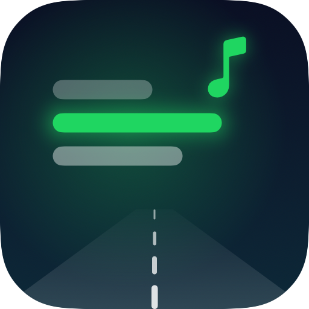

# Lyricar: the complete guide

This guide explains **how Lyricar works** and walks you through **every step of the setup**, including where to find each ID. It also covers the most common problems.

**Contents**

1. [How Lyricar works](#1-how-lyricar-works)
2. [What you need](#2-what-you-need)
3. [Setup, step by step](#setup-step-by-step)
   - [Step 1: Create the Spotify app and get the Client ID](#step-1-create-the-spotify-app-and-get-the-client-id)
   - [Step 2: Choose how to install](#step-2-choose-how-to-install)
     - [Method A: Xcode (paid or free Apple account)](#method-a-xcode-paid-or-free-apple-account)
     - [Method B: AltStore or SideStore](#method-b-altstore-or-sidestore)
     - [Method C: Sideloadly](#method-c-sideloadly)
     - [Method D: TestFlight](#method-d-testflight)
     - [Other methods](#other-methods)
   - [Step 3: First launch](#step-3-first-launch)
   - [Step 4: Set it up for the car](#step-4-set-it-up-for-the-car)
4. [Using the app](#4-using-the-app)
5. [Troubleshooting](#5-troubleshooting)
6. [How long does the installed app last?](#6-how-long-does-the-installed-app-last)
7. [FAQ](#7-faq)

---

## 1. How Lyricar works

### The big picture

```
                    every 3 s
 ┌──────────────┐  "what's playing,      ┌─────────────────────────────┐
 │ Spotify      │   and where?"          │ Lyricar app (iPhone)        │
 │ Web API      │ ─────────────────────► │                             │
 └──────────────┘                        │  1. knows the song + time   │
                                         │  2. finds the current line  │      ┌──────────┐
 ┌──────────────┐  once per song         │  3. updates the Live        │ ───► │ CarPlay  │
 │ LRCLIB       │  "lyrics with          │     Activity on each line   │      │ dashboard│
 │ (lrclib.net) │   timestamps"          │                             │      └──────────┘
 └──────────────┘ ─────────────────────► └─────────────────────────────┘
```

Lyricar has two data sources:

- **Spotify Web API.** iOS does not let one app see what another app is playing, so Lyricar asks Spotify's servers directly through the `currently-playing` endpoint. Spotify returns the song, whether it is playing, and the **position in milliseconds**. This is why you have to sign in with Spotify.
- **LRCLIB.** Spotify does not give lyrics to third-party apps. Lyricar downloads them from [LRCLIB](https://lrclib.net), a free and open database of **LRC** lyrics, a format where each line carries a timestamp:
  ```
  [00:12.40] First line of the song
  [00:15.90] Second line
  ```
  Lyrics are cached on the phone, so each song is downloaded only once.

### Keeping in sync

When Spotify reports that a song is at position `p`, Lyricar works out the moment the song started:

```
song start = (time of the request) − p
```

Five times a second, the app compares the current time with that start time and picks the line whose timestamp has just passed. Every 3 seconds it checks with Spotify again:

- If the estimate has drifted by **less than 1 second**, it is corrected gently. This smooths out network jitter.
- If it is off by **more than 1 second**, you skipped, seeked or resumed, so the app re-aligns immediately.
- If the **song ID** changed, it fetches the new lyrics.

The **per-song offset** is added on top of all this, for songs whose LRCLIB lyrics are slightly off.

### Why a Live Activity and not just a widget?

The first version used only a **widget**. It drifted out of sync and sometimes froze. Here is why:

- A widget cannot run code continuously. It gives iOS a *timeline* of pre-computed "pages" with timestamps, and iOS decides when to actually redraw. On CarPlay these redraws can be **seconds late**.
- iOS also gives every widget a **daily budget** of refreshes. Once it is used up, the widget stops updating.

A **Live Activity** (the same technology behind food-delivery and sports-score banners) can be updated directly by the app whenever it wants. Since iOS 26, Live Activities are also shown on **CarPlay**. Lyricar updates it every time the line changes. The widget is still included as a simpler fallback.

### Driving Mode: staying alive in the background

To update the Live Activity, the app must keep running while it is in the background, with the screen locked and the phone in your pocket. iOS normally suspends background apps after a few seconds. **Driving Mode** uses two techniques at once:

| Technique | What it does | Weak spot |
|---|---|---|
| **Silent audio** | Plays silence, mixed with Spotify (it never interrupts or lowers your music). iOS keeps apps that play audio alive. | A **phone call** or Siri interrupts it, and iOS may not let it resume. |
| **Background location** | Uses the same mechanism as navigation apps. You will see the location arrow in the status bar. | Needs location permission. |

With both active, a phone call no longer freezes the lyrics. The location is **never stored or sent anywhere**: it is only used to keep the app awake.

Driving Mode turns itself off when there has been **no music for 15 minutes and CarPlay is disconnected**. You can also stop it manually or with an automation.

> These techniques are why Lyricar is a personal project: App Store review does not accept apps that use them just to stay awake.

### Where your data goes

| Data | Where it lives |
|---|---|
| Spotify login (tokens) | iOS Keychain, on your phone only |
| Lyrics | Cache on your phone |
| Settings, offsets, diagnostics | On your phone only |
| Network requests | Only to `accounts.spotify.com`, `api.spotify.com` and `lrclib.net` |

There is no Lyricar server and no analytics.

---

## 2. What you need

**Always:**

- [ ] An **iPhone** with **iOS 26** or later
- [ ] A car with **CarPlay**, wired or wireless
- [ ] A **Spotify account**, plus access to a **Spotify Premium** account to create the Spotify app (see [Step 1](#step-1-create-the-spotify-app-and-get-the-client-id))
- [ ] An **Apple ID**, free or with a paid Apple Developer Program membership

**Depending on how you install** (see [Step 2](#step-2-choose-how-to-install)):

- a **Mac with Xcode 26** (Method A), or
- a **Mac or Windows PC** to run AltServer, SideStore's one-time setup or Sideloadly (Methods B and C)

---

## Setup, step by step

Whatever method you choose, you always start by creating your own Spotify app (Step 1). Then you pick how to get Lyricar onto your iPhone (Step 2).

### Step 1: Create the Spotify app and get the Client ID

The **Client ID** tells Spotify which app is asking for access. It is **not a secret**: no password is needed, because Lyricar uses the secure *PKCE* login flow.

1. Go to **[developer.spotify.com/dashboard](https://developer.spotify.com/dashboard)** and log in with your Spotify account.
2. If asked, accept the **Developer Terms of Service**.
3. Click **Create app** and fill in the form:

   | Field | What to enter |
   |---|---|
   | **App name** | `Lyricar` (anything works) |
   | **App description** | `Synced lyrics on CarPlay` (anything works) |
   | **Website** | leave empty |
   | **Redirect URIs** | `lyricar://callback`, then click **Add** |
   | **Which API/SDKs…** | ✅ **Web API** only. Do **not** tick iOS, Android or the others. |

4. Tick the Terms checkbox and click **Save**.
5. On the app page, click **Settings** (top right).
6. Under **Basic Information**, copy the **Client ID**, a 32-character string of letters and numbers. You do **not** need the *Client secret*, so never share it.
7. Still in **Settings**, open the **User Management** tab and add the **name and email of every Spotify account** that will sign in to Lyricar, **including your own** if it differs from the account that owns the app. Use the email shown on [spotify.com/account](https://www.spotify.com/account) for each account.

> [!IMPORTANT]
> **"I can't tick Web API" / "Upgrade to Spotify Premium to access the Web API"**
>
> Spotify only lets **Premium** accounts use the Web API in development mode.
> - Check that you are logged in with the right account: compare the top-right corner of the dashboard with [spotify.com/account](https://www.spotify.com/account). Try a private browser window.
> - **Family / Duo plan members:** the checkbox may stay disabled. Ask the **plan manager** to create the app with their account and add *you* in **User Management**.
> - **Using someone else's Premium account works too.** Whoever has Premium creates the app and adds your email in User Management. You then sign in to Lyricar with **your own** account and see **your own** music. They need to keep their Premium and keep the app on their dashboard.

### Step 2: Choose how to install

Apple only lets apps outside the App Store run if they are **signed with a certificate** linked to an Apple account. The method you choose decides which certificate is used and **how long the app keeps working** before it has to be renewed.

| Method | What you need | Certificate | The app lasts | Effort |
|---|---|---|---|---|
| **[A. Xcode + paid account](#method-a-xcode-paid-or-free-apple-account)** ⭐ | Mac + Xcode, Apple Developer Program (99 $/€ per year) | Your developer certificate | **1 year** | One-time setup |
| **[A. Xcode + free Apple ID](#method-a-xcode-paid-or-free-apple-account)** | Mac + Xcode | Free personal certificate | **7 days**, then rebuild | Weekly |
| **[B. AltStore or SideStore](#method-b-altstore-or-sidestore)** | Mac or Windows PC (for setup), free Apple ID | Free personal certificate | **7 days, renewed automatically** | Automatic in the background |
| **[C. Sideloadly](#method-c-sideloadly)** | Mac or Windows PC, free or paid Apple ID | Free (7 days) or paid (1 year) | **7 days** or **1 year** | Weekly with a free ID |
| **[D. TestFlight](#method-d-testflight)** | The **TestFlight** app. The person sharing it needs a paid account. | Apple's (App Store) | **90 days** per build | Install updates from TestFlight |
| **[Other methods](#other-methods)** | — | Signing services, enterprise certificates… | Varies | Read the notes |

> **Which one?** If you have a Mac, **Method A** is the simplest and the only one tested end to end. With a paid account you install once a year. Without a Mac, use **Method B**: AltStore or SideStore renew the app for you every week.

> [!NOTE]
> **Free Apple IDs have limits:** apps last 7 days, you can have at most **3 sideloaded apps** active at the same time, and you can register at most **10 App IDs per week**. Lyricar uses 2 (the app and its widget). If the App Group isn't available, the app still works, but the **widget** can't see your Spotify login. The Live Activity on CarPlay is not affected.

### Method A: Xcode (paid or free Apple account)

Build Lyricar from the source code and install it directly from your Mac. You'll put three values in one file:

| Value | Example | Where it comes from |
|---|---|---|
| `SPOTIFY_CLIENT_ID` | `1a2b3c4d5e6f…` (32 characters) | Spotify Developer Dashboard ([Step 1](#step-1-create-the-spotify-app-and-get-the-client-id)) |
| `DEVELOPMENT_TEAM` | `ABCDE12345` (10 characters) | Your Apple account ([A1](#a1-find-your-apple-team-id)) |
| `APP_BUNDLE_ID` | `com.yourname.lyricar` | You choose it ([A2](#a2-choose-a-bundle-id)) |

**Paid or free?** Both work the same way. With the **Apple Developer Program** (99 $/€ per year) the app lasts **one year**. With a **free Apple ID**, just add it in Xcode → Settings → Accounts: Xcode creates a *Personal Team*, but the app expires after **7 days** and you'll have to press ▶︎ Run again.

#### A1. Find your Apple Team ID

The **Team ID** is a 10-character code that identifies your Apple developer account. Xcode uses it to sign the app.

**Option A: website (easiest)**
1. Go to **[developer.apple.com/account](https://developer.apple.com/account)** and sign in.
2. Scroll to **Membership details**.
3. Copy the **Team ID**, for example `ABCDE12345`.

While you are there, check the **Expiration Date** of your membership (see [section 6](#6-how-long-does-the-installed-app-last)).

**Option B: Keychain Access on your Mac**
1. Open **Keychain Access** and search for `Apple Development`.
2. Double-click the certificate.
3. The **Organizational Unit** field is your Team ID.

**Option C: Xcode**
1. **Xcode → Settings → Accounts.** Add your Apple ID if it is not there.
2. Open any project, go to a target → **Signing & Capabilities**, and pick your team. The Team ID then appears in **Build Settings → Development Team**.

#### A2. Choose a Bundle ID

The **Bundle ID** is the app's unique identifier, written in reverse-domain style. You **make it up**, but it must be unique across all of Apple. Good examples:

```
com.yourname.lyricar
io.github.yourgithubname.lyricar
```

Use only letters, numbers, dots and hyphens. Lyricar derives the other identifiers from it automatically:

| Identifier | Value |
|---|---|
| App | `com.yourname.lyricar` |
| Widget | `com.yourname.lyricar.widget` |
| App Group (lets the app and widget share the login) | `group.com.yourname.lyricar` |

If Xcode later says the Bundle ID *"is not available"* or is *"already in use"*, just pick another one.

#### A3. Configure the project

1. Download the project:
   ```sh
   git clone https://github.com/Gennaro0408-bit/lyricar.git
   cd lyricar
   ```
   No git? On GitHub click **Code → Download ZIP** and unzip it.
2. Create your personal configuration file from the template:
   ```sh
   cp Config/Local.xcconfig.example Config/Local.xcconfig
   ```
   Or, in Finder, duplicate `Config/Local.xcconfig.example` and rename the copy to `Local.xcconfig`.
3. Open `Config/Local.xcconfig` in any text editor and fill in your three values:
   ```
   DEVELOPMENT_TEAM = ABCDE12345
   APP_BUNDLE_ID = com.yourname.lyricar
   SPOTIFY_CLIENT_ID = 1a2b3c4d5e6f7a8b9c0d1e2f3a4b5c6d
   ```
   No quotes, and nothing else on those lines.

`Local.xcconfig` is listed in `.gitignore`, so your IDs **never end up on GitHub**, even if you publish your fork.

> **Custom redirect URI (optional):** if your Spotify app already uses a different redirect, for example `myapp://callback`, add `CALLBACK_SCHEME = myapp` to `Local.xcconfig`. The redirect URI on the Spotify dashboard must always be `<CALLBACK_SCHEME>://callback`.

#### A4. Build and install

1. Double-click **`Lyricar.xcodeproj`** to open it in Xcode.
2. Connect your iPhone with the cable, unlock it, and tap **Trust** if asked.
3. On the iPhone, turn on **Developer Mode**: **Settings → Privacy & Security → Developer Mode**. The iPhone restarts.
4. In Xcode's toolbar, select your iPhone as the run destination.
5. Click **▶︎ Run** (or press ⌘R).

The first time, Xcode registers the Bundle IDs and the App Group on your account. This is the **Automatically manage signing** option, which should stay on. Leave it to Xcode: you do **not** need to download or import provisioning profiles by hand.

If your iPhone says *"Untrusted Developer"*, go to **Settings → General → VPN & Device Management**, tap your developer account and tap **Trust**.

### Method B: AltStore or SideStore

[AltStore](https://altstore.io) and [SideStore](https://sidestore.io) are free tools that install apps with **your own Apple ID** and **renew them automatically** before the 7 days run out. You don't need Xcode or a Mac: Windows works too.

| | AltStore | SideStore |
|---|---|---|
| Setup | Install **AltServer** on a Mac or Windows PC, then AltStore on the iPhone | A computer is needed **only once** for the setup |
| Weekly renewal | Automatic, when the iPhone and the computer running AltServer are on the **same Wi-Fi** | Automatic, **from the iPhone alone**, through a local VPN app |

1. Install AltStore or SideStore by following the official guide on their website.
2. On your iPhone, download **`Lyricar.ipa`** from the [latest release](https://github.com/Gennaro0408-bit/lyricar/releases/latest) on GitHub.
3. Open AltStore or SideStore → **My Apps** → **+**, and select `Lyricar.ipa`.
4. Sign in with your Apple ID if asked. The tool signs Lyricar with your free certificate.
5. Go to [Step 3: First launch](#step-3-first-launch). Since this version has no built-in Client ID, Lyricar will ask you to **paste your Spotify Client ID**.

> [!NOTE]
> These tools change the app's Bundle ID and App Group to match your account. Lyricar detects this automatically. In the worst case only the **widget** can't see your login, while the Live Activity and CarPlay keep working.
> This method has **not yet been tested end to end** with Lyricar. If something doesn't work, please open an [issue](https://github.com/Gennaro0408-bit/lyricar/issues).

### Method C: Sideloadly

[Sideloadly](https://sideloadly.io) is a free Mac and Windows app that signs and installs an `.ipa` over USB or Wi-Fi.

1. Download **`Lyricar.ipa`** from the [latest release](https://github.com/Gennaro0408-bit/lyricar/releases/latest).
2. Open Sideloadly, connect the iPhone, drag `Lyricar.ipa` into the window and enter your Apple ID.
3. Click **Start**. On the iPhone, trust the certificate in **Settings → General → VPN & Device Management**, and turn on **Developer Mode** if asked.
4. Go to [Step 3: First launch](#step-3-first-launch) and paste your Spotify Client ID when asked.

With a **free Apple ID** the app lasts **7 days**: repeat the steps above (your settings are kept). With a **paid** developer account, Sideloadly can sign it for **one year**.

> This method has not yet been tested end to end with Lyricar either.

### Method D: TestFlight

[TestFlight](https://developer.apple.com/testflight/) is Apple's official beta-testing app. Whoever has a **paid Apple Developer account** uploads Lyricar once, and the testers install it from the TestFlight app, **like any App Store app**: no computer, no weekly renewal. Each build lasts **90 days**, and updates arrive in TestFlight.

The TestFlight build has **no built-in Client ID**: on first launch each tester pastes the Client ID of their own Spotify app (see [Step 3](#step-3-first-launch)).

**For testers**

1. Install **TestFlight** from the App Store.
2. Open the invitation link or email you received and tap **Accept / Install**.
3. Go to [Step 3: First launch](#step-3-first-launch).

**For the account owner (uploading the build)**

1. On [App Store Connect](https://appstoreconnect.apple.com) → **Apps** → **+** → **New App**: platform iOS, a name (it must be unique on the App Store, for example *Lyricar – CarPlay Lyrics*), language, the **same Bundle ID** as `APP_BUNDLE_ID`, and any SKU.
2. On the Mac, with [Method A](#method-a-xcode-paid-or-free-apple-account) already set up, run:
   ```sh
   sh tools/testflight.sh upload
   ```
   The script builds Lyricar **without your Client ID**, signs it for the App Store and uploads it. Every upload gets a new build number automatically.
3. After 5–30 minutes the build appears in App Store Connect → your app → **TestFlight**.
4. Add testers:
   - **Internal testers** (up to 100): people added to your team in **Users and Access**. **No review** is needed, and they can install right away.
   - **External testers** (up to 10,000, also via a public link): the first build goes through Apple's **Beta App Review**.

> [!WARNING]
> **External testing may be rejected.** To stay in sync in the background, Lyricar uses silent audio and background location, and Apple's review usually rejects these techniques when they're only used to stay awake. Internal testing doesn't go through review.

> **Spotify limit:** in development mode a Spotify app accepts only the accounts listed in its User Management, and only a small number of them. That's why each tester should ideally create their **own** Spotify app and paste its Client ID. You can also add them to yours, up to that limit.

### Other methods

- **Paid "signing services" and shared enterprise certificates.** Some websites sell certificates that let you install any `.ipa` for a year. ⚠️ **Not recommended:** they are unofficial, Apple often revokes them (the app suddenly stops opening), and you're trusting a third party with an app that has access to your Spotify login.
- **Building the `.ipa` yourself:** run `sh tools/build-ipa.sh` on a Mac. It creates `build/Lyricar.ipa` with no Client ID and no personal data, ready for AltStore, SideStore or Sideloadly.

### Step 3: First launch

> **Language:** Lyricar is available in **English** and **Italian** and follows your iPhone's language. To pick a different one just for Lyricar, tap **Language** in the app (or go to **Settings → Lyricar → Language**) and choose it under **Preferred Language**.

1. Open **Lyricar**.
   - If you installed it with **AltStore, SideStore or Sideloadly**, a **Spotify Client ID** field appears first. Paste the Client ID from [Step 1](#step-1-create-the-spotify-app-and-get-the-client-id). Make sure your Spotify app's Redirect URI is exactly the one shown under the field, `lyricar://callback` (the **Copy** button helps). You can change it later from the **⋯** menu → **Change Spotify Client ID**.
2. Tap **Sign in with Spotify**.
3. Sign in with **your** Spotify account, the one added in User Management. The login page always lets you choose the account.
4. When asked for **location**, choose **Allow While Using App**.
5. When asked about **Live Activities**, allow them. If you missed it: **Settings → Lyricar → Live Activities**.
6. Play a song on Spotify. Within a few seconds you should see:
   - the lyrics scrolling inside the app;
   - after you lock the phone, the lyrics on the **Lock Screen** and in the **Dynamic Island**.

### Step 4: Set it up for the car

**See the lyrics on CarPlay**

1. Connect the iPhone to the car, by cable or wirelessly.
2. Make sure **Driving Mode** is on in Lyricar. By default it turns on whenever you open the app.
3. The Live Activity appears on the CarPlay dashboard or on the widgets page (the first page on the left). If you don't see it, check **iPhone Settings → General → CarPlay → [your car]** and make sure widgets and Live Activities are enabled.

**Optional: start and stop automatically**

iOS only allows a Live Activity to be *started* while the app is open. These two automations open Lyricar for you when you get in the car and stop it when you get out:

1. Open the **Shortcuts** app → **Automation** tab → **+**.
2. Choose **CarPlay → Connects → Run Immediately → Next**.
3. Search for the **Start lyrics in the car** action from Lyricar and add it. Tap **Done**.
4. Repeat with **CarPlay → Disconnects** and the **Stop lyrics in the car** action.

**Optional: add the widget**

Lyricar also includes a small widget, *Spotify Lyrics*. It is less precise than the Live Activity, but needs no app running. Add it from the CarPlay widgets page (long-press → **+**) or from the iPhone Home Screen.

---

## 4. Using the app

- **Driving Mode switch.** Turns on background updates and the Live Activity.
- **Per-song offset.** If a song's lyrics run **late**, increase the offset. If they run **early**, decrease it. The value is saved **for that song only**. Use **Reset this song's offset** to undo it, or reset all songs at the bottom of the screen.
- **Diagnostics**. A log of what happened: song changes, re-alignments, audio interruptions (calls, Siri), Live Activity state, and network errors. The share button sends it as text, which is handy when reporting a bug.
- **Pull to refresh.** Forces an immediate check with Spotify.
- **Language.** Opens Lyricar's page in Settings, where you can switch between English and Italian under **Preferred Language**.

---

## 5. Troubleshooting

### Spotify / login

| Symptom | Cause and fix |
|---|---|
| Web API checkbox greyed out / "Upgrade to Spotify Premium" | The account creating the app is not Premium. See the box in [Step 1](#step-1-create-the-spotify-app-and-get-the-client-id). |
| `INVALID_CLIENT: Invalid redirect URI` | The redirect on the dashboard doesn't match. It must be exactly `lyricar://callback`, or `<CALLBACK_SCHEME>://callback` if you changed it. |
| `INVALID_CLIENT: Invalid client` | `SPOTIFY_CLIENT_ID` is missing or wrong in `Local.xcconfig`. Rebuild after fixing it. |
| *"Account not authorized…"* (HTTP 403) after login | Your Spotify account is not in the app's **User Management** list on the dashboard. Add it. |
| *"Nothing playing"* while music plays | Music is playing from a source other than your Spotify account (radio, another app, or another account), or Spotify is paused. |

### Installation

| Error | Fix |
|---|---|
| *Signing for "Lyricar" requires a development team* | `DEVELOPMENT_TEAM` is missing in `Config/Local.xcconfig`, or Xcode overrode it. Check the file, then in **Signing & Capabilities** make sure *Automatically manage signing* is on and no team is set by hand. |
| *Embedded binary's bundle identifier is not prefixed with the parent app's bundle identifier* | Someone edited the Bundle IDs by hand in Xcode. Remove the manual edits (or regenerate the project with `xcodegen generate`) and set only `APP_BUNDLE_ID` in `Local.xcconfig`. |
| *Failed to register bundle identifier* / *not available* | Another developer already uses that Bundle ID. Choose a different `APP_BUNDLE_ID`. |
| Errors about **App Groups** or a profile that *doesn't support* them | You selected a downloaded or wildcard profile ("XC Wildcard"). Wildcard profiles can't contain App Groups. Use **Automatically manage signing** instead. |
| *Untrusted Developer* on the iPhone | **Settings → General → VPN & Device Management → Trust**. |
| *Developer Mode required* | **Settings → Privacy & Security → Developer Mode**. |
| AltStore / Sideloadly: *maximum number of App IDs* reached | Free Apple IDs can register 10 App IDs per week, and Lyricar uses 2. Wait a few days, or use an Apple ID you don't use for other apps. |
| AltStore / Sideloadly: *maximum number of apps* reached | Free Apple IDs can have 3 sideloaded apps at a time (AltStore counts as one). Remove one you don't use. |
| The app stopped opening after a week | The free certificate expired. Renew it in AltStore or SideStore, or reinstall (see [section 6](#6-how-long-does-the-installed-app-last)). |
| The widget says *"Sign in to Spotify from the Lyricar app"*, but the app works | The App Group isn't available with your signing method, so the widget can't see the login. Use the Live Activity (Driving Mode), which doesn't need it. |

### Lyrics and sync

| Symptom | Cause and fix |
|---|---|
| Lyrics are always early or late on **one** song | LRCLIB has lyrics for a different version of that song. Use the **per-song offset**. The Diagnostics log shows `⚠️ Lyrics found are for a version with a different duration` when this is likely. |
| Lyrics are off on **every** song | Usually a constant CarPlay display delay. Set a small offset, or check that you don't have old offsets saved (use **Reset offsets for all songs**). |
| *"No synced lyrics available"* | LRCLIB has no time-stamped lyrics for that song. You can contribute them at [lrclib.net](https://lrclib.net). |
| Lyrics **freeze** on one line | iOS suspended the app. Check that location permission is granted and Driving Mode is on, then look in Diagnostics for `⚠️ No updates for … s` or `interruption began`. |
| No Live Activity on CarPlay | Enable Live Activities in **Settings → Lyricar**, turn Driving Mode off and on, and check the CarPlay settings in [Step 7](#step-4-set-it-up-for-the-car). |
| Widget is late or frozen | Expected: iOS limits widget refreshes. Use the Live Activity (Driving Mode). |

---

## 6. How long does the installed app last?

It depends on the [installation method](#step-2-choose-how-to-install):

| Method | Lasts | How to renew |
|---|---|---|
| Xcode + paid account | 1 year | Press ▶︎ Run in Xcode again before it expires |
| Xcode + free Apple ID | 7 days | Press ▶︎ Run in Xcode again |
| AltStore / SideStore | 7 days | Automatic (AltStore: keep AltServer running on the same Wi-Fi) |
| Sideloadly | 7 days (free) / 1 year (paid) | Install the `.ipa` again |
| TestFlight | 90 days per build | The owner uploads a new build, and testers update from TestFlight |

Your settings and Spotify login are kept when you renew.

**Paid account, in detail.** An app installed from Xcode is signed with a **certificate** and a **provisioning profile**. It keeps working until **the first** of these dates:

1. the **certificate** expiry (check in Keychain Access → *Apple Development* certificate → *Expires*);
2. the **provisioning profile** expiry (Xcode creates them with a one-year validity on paid accounts);
3. the end of your **Apple Developer Program membership** (developer.apple.com/account → *Membership details*), if it isn't renewed;
4. revocation of the certificate, or removal of the iPhone from your account.

**To extend it:** before the expiry date, connect the iPhone and press **▶︎ Run** in Xcode again. Xcode renews the certificate and profile automatically, as long as your membership is active.

---

## 7. FAQ

**Can I see the lyrics without a Spotify Premium account?**
You can *use* Lyricar with any Spotify account added in User Management. The Spotify app itself, however, must be **created** by a Premium account, which can be someone else's.

**Can I share it with friends without them needing a computer?**
Yes, with [TestFlight](#method-d-testflight) if you have a paid Apple Developer account. Add them as internal testers, and they install Lyricar from the TestFlight app.

**Can I install it without a Mac?**
Yes: use [AltStore or SideStore](#method-b-altstore-or-sidestore) from a Windows PC, or [Sideloadly](#method-c-sideloadly). Download the ready-made `.ipa` from the GitHub Releases page.

**Does Lyricar work with Apple Music, YouTube Music, etc.?**
Not at the moment. Lyricar reads playback from Spotify's Web API.

**Does it drain the battery?**
Driving Mode uses about as much power as a navigation app running in the background. In the car the phone is usually charging, and Driving Mode turns itself off when CarPlay is disconnected and nothing has played for 15 minutes.

**Why isn't it on the App Store?**
It relies on background techniques (silent audio and background location) that App Review rejects when they are used only to stay awake, and it shows text to drivers. It's meant as a personal, sideloaded project.

**Is my Client ID secret? Can I publish my fork?**
The Client ID isn't a password. Still, keep it in `Config/Local.xcconfig`, which is git-ignored, so your fork stays clean and others create their own Spotify app.
